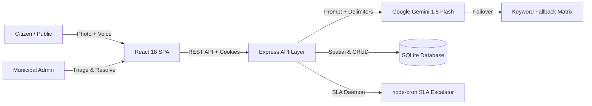

# CivicResolve

> **AI-Powered, Accessible Civic Grievance Resolution Platform**  
> Built for Indian Municipalities • Coimbatore Seeded Dataset • WCAG 2.2 AA Compliant

---

## 1. Problem & Solution

### The Problem

Traditional municipal grievance portals suffer from severe bottlenecks:

- **High reporting friction**: Citizens struggle with complex bureaucratic categorization drop-downs and department routing.
- **Language barriers**: Non-English speakers face limited accessibility when submitting complaints.
- **Unprioritized queues**: Minor complaints bury life-threatening emergencies near hospitals and schools.
- **Duplicate fragmentation**: Hundreds of citizens report the same pothole, diluting urgency and overwhelming triage officers.
- **Fake resolutions**: Grievances are marked "Resolved" without verifiable proof.

### The Solution: CivicResolve

1. **Photo-First Multimodal AI**: Citizens upload an image or speak in **English, Tamil, or Hindi**. Google Gemini 1.5 Flash auto-fills title, description, category, and severity while allowing citizen editing.
2. **Explainable Impact Score (0–100)**: Combines AI urgency, hazard assessment, proximity to Coimbatore hospitals and schools (CMCH, PSG, etc.), community support, and age factor with full transparency.
3. **100m Duplicate Detection & Support**: Real-time Haversine spatial analysis surfaces nearby open complaints with an instant "Support (+2 pts)" endorsement.
4. **SLA Countdown & Auto-Escalation**: Dynamic department SLA tracking; overdue issues auto-escalate to the top of the admin triage queue via `node-cron`.
5. **Gemini Before/After Verification**: Admins upload resolution photo proof; Gemini visually inspects before/after states; citizens confirm or reopen.
6. **Zero-Downtime Resilience**: Seamless rule-based fallback guarantees complaints are never dropped if AI is offline.

---

## 2. Architecture



---

## 3. Quick Start in 4 Commands

No Docker required. Node.js 20+ and npm only.

```bash
# 1. Clone repository
git clone https://github.com/your-username/civicresolve.git
cd CivicResolve

# 2. Install monorepo dependencies
npm install

# 3. Setup SQLite database & seed 40 realistic Coimbatore grievances
npm run db:setup

# 4. Start API (port 5000) and Web (port 5173) concurrently
npm run dev
```

Visit **http://localhost:5173** to use the application.

---

## 4. Seeded Demo Accounts

| Role        | Email                       | Password      | Permissions                                                             |
| :---------- | :-------------------------- | :------------ | :---------------------------------------------------------------------- |
| **Admin**   | `admin@civicresolve.gov.in` | `Admin@123`   | Triage queue, status transitions, SLA settings, resolution verification |
| **Citizen** | `citizen@civicresolve.org`  | `Citizen@123` | Submit reports, track grievances, endorse duplicates, reopen complaints |

---

## 5. 2-Minute Demo Script for Evaluators

1. **Photo-First AI Reporting**:
   - Navigate to `/report`.
   - Upload a photo of a road defect or click "Use sample observation".
   - Switch language to **Tamil (தமிழ்)** or **Hindi (हिन्दी)** and use the microphone button to dictate.
   - Observe Gemini auto-classifying the problem, assigning high priority, and proposing the "Roads & Bridges" department.
2. **Spatial Duplicate Detection**:
   - Select a coordinate near Gandhipuram (e.g. `11.0168, 76.9558`).
   - Notice the prompt flagging an existing complaint within 100 meters. Click **"Support Existing Complaint"** to boost its score by $+2$.
3. **Tracking & Explainable Score Breakdown**:
   - Submit a new grievance or search tracking code `CR-2026-0001` on `/track`.
   - View the **Explainable Impact Score (0–100)** with interactive breakdowns (Urgency, Hazard, Hospital Proximity, Support, Age) and Gemini's reasoning.
4. **Admin Resolution with Before/After Verification**:
   - Log in as `admin@civicresolve.gov.in` / `Admin@123` and go to `/admin`.
   - Open any high-priority issue and click **"Resolve"**.
   - Upload an "after" image. Observe Gemini inspecting the repair and outputting `verified: true` with inspection notes.
5. **Civic Health Map & Analytics**:
   - Navigate to `/admin` -> **"Civic Map"** to see Leaflet heatmap pins across Coimbatore.
   - Switch to **"Table View"** to inspect full WCAG 2.2 AA accessible markup.
   - Check `/public` for anonymized public municipal transparency statistics.

---

## 6. Verification & Quality Commands

```bash
npm run lint          # 0 ESLint warnings/errors
npm run typecheck     # Strict TypeScript: 0 errors
npm test              # 57/57 tests passing across monorepo
npm run test:coverage # >80% coverage on API logic
npm run build         # Production builds for shared, api, and web
```
